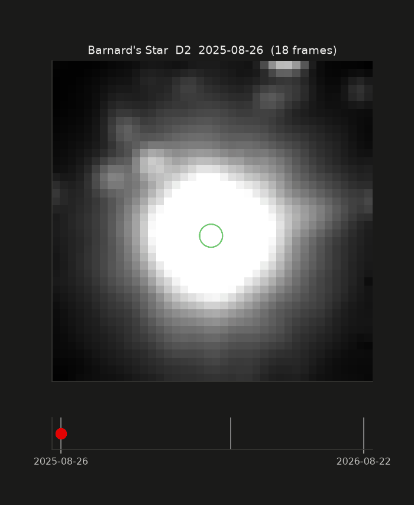
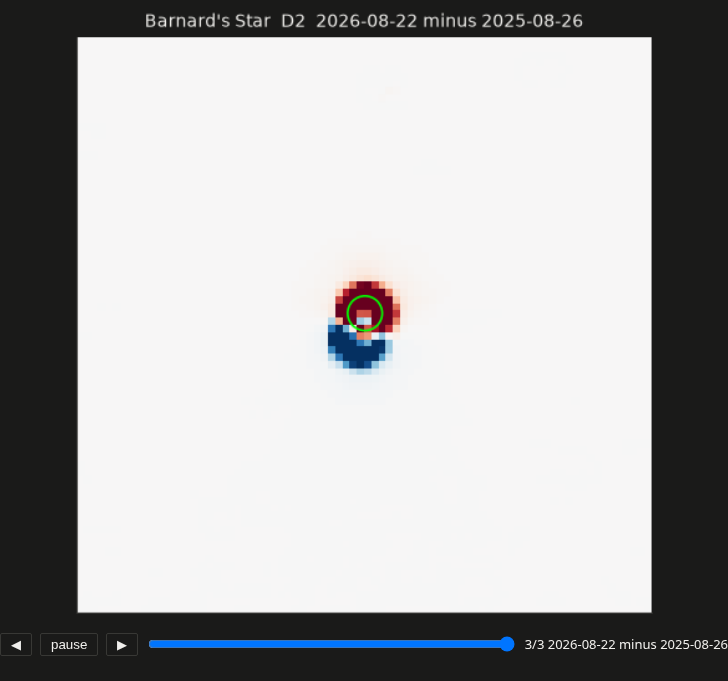
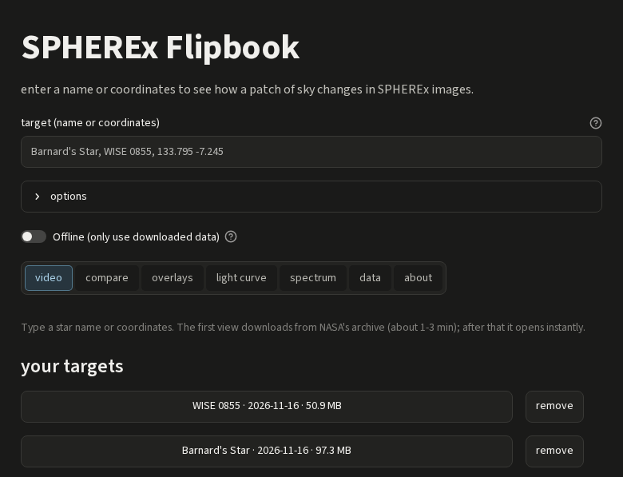
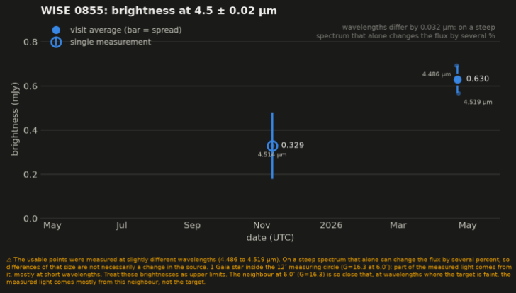
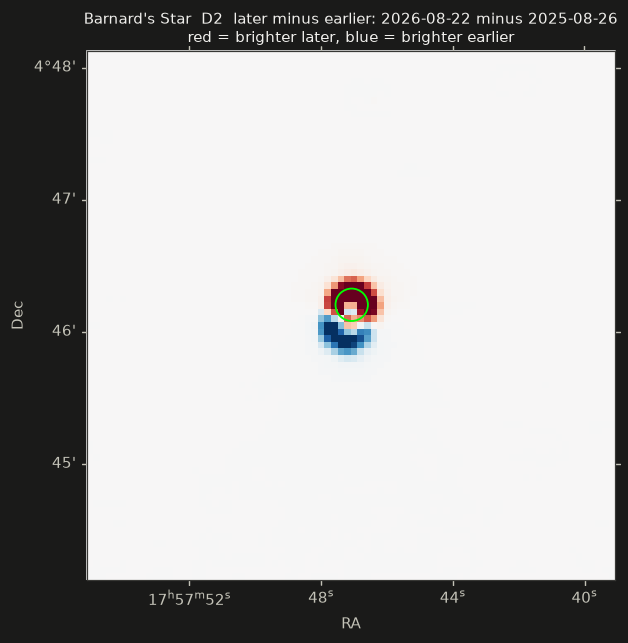
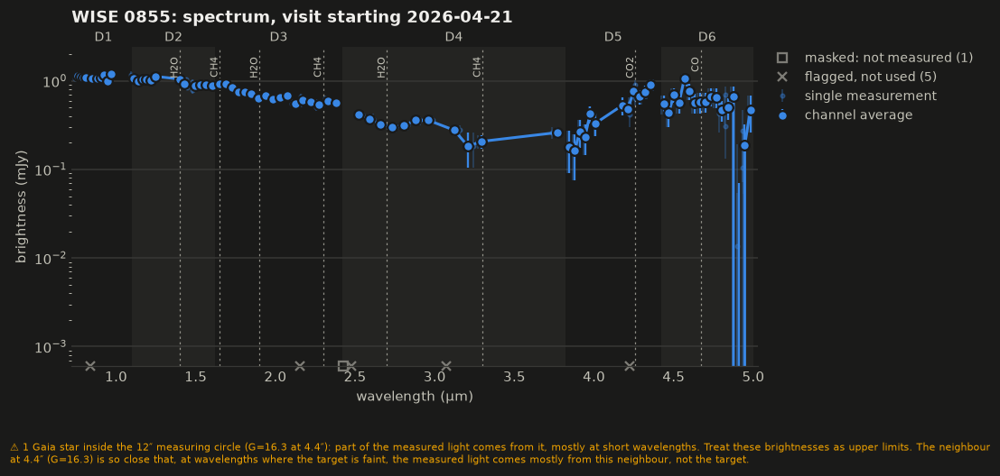
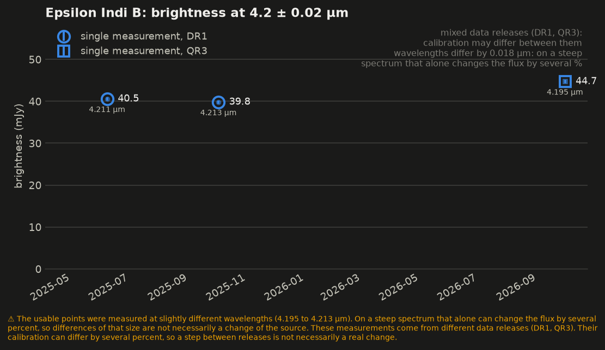
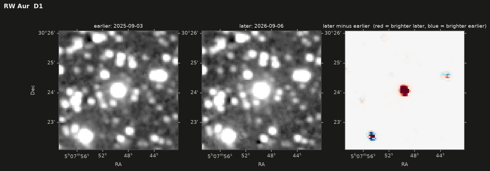
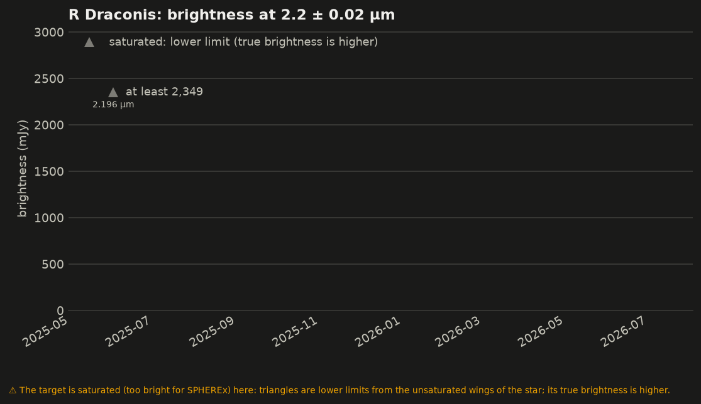
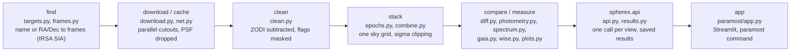

# SPHEREx Flipbook

[](pyproject.toml)
[](LICENSE)
[](https://github.com/UTMOS12345/spherex_project/actions/workflows/tests.yml)
[](https://github.com/UTMOS12345/spherex_project/actions/workflows/docker.yml)



**Type a star name or sky position and watch that patch of sky change across NASA SPHEREx
visits: motion, brightness changes and spectra, straight from the IRSA archive.**

*Barnard's Star, the fastest-moving star in the sky, in three SPHEREx visits (detector D2,
2′ field). The green circle is where its proper motion puts it on each date.*

Built for the **NASA Space Apps Challenge 2026 - Planet X and SPHEREx**. Without installing
anything, you can browse the [gallery](docs/index.html) (static, also served by GitHub Pages)
and the [tutorial notebook](notebooks/tutorial.ipynb).

## Install

**With pipx** (recommended: the app gets its own environment and a `paramost` command):

```
pipx install git+https://github.com/UTMOS12345/spherex_project.git
paramost
```

**With Docker:**

```
docker run -p 8501:8501 -v paramost-cache:/data/cache ghcr.io/utmos12345/paramost:1.0.0
```

(or build it yourself: `docker build -t paramost .`). Then open http://localhost:8501.

> **The first view of a target downloads its images from NASA's archive (IRSA), which takes
> about 1-3 minutes. After that it opens instantly**, also after a restart: the images and the
> computed results stay in a local cache. The app shows how many images a view needs and waits
> for you to press **download**. Nothing is downloaded before that.

Python 3.10 or newer. Options: `paramost --port 8502`, `--no-browser`, `--offline` (only data
already downloaded), `--cache-dir PATH`, `paramost cache-info` (where the cache is, its size,
which targets), `paramost --version`. From a source checkout: `pip install -e ".[test]"` and
`python -m paramost`.

## What it does

Every SPHEREx visit of the position is cleaned and stacked onto one fixed sky grid. The app then
shows the results in several views:
- **Video:** one picture per visit, as a player or an animated GIF, in three modes: normal,
  each visit minus the first, or each visit minus the mean.
- **Pictures:** difference pictures (later minus earlier), deep stacks, colour (RGB) pictures
  from three detectors, and a "band difference" in which ordinary stars cancel and cold objects
  remain.
- **Overlays:** Gaia DR3 and CatWISE2020 sources, moved to the picture's date, with
  proper-motion arrows. Known asteroids come from SkyBoT when that service answers.
- **Light curve:** at one wavelength.
- **Spectrum:** measured on the fly from the images, binned into the 102 SPHEREx channels,
  for the latest visit or for every visit.
- **Flags view:** the data-quality flags of each exposure.

You can type a name, decimal degrees or sexagesimal coordinates, choose a field of view of
1-10′, and copy the link: the URL keeps the target and settings.



*The video player in difference mode (Barnard's Star, D2, 2026-08-22 minus 2025-08-26): red
where the star is now, blue where it was a year earlier.*

Targets you have downloaded appear on the start screen under **your targets**, newest first,
with their size on disk. A button reopens a target with the settings you last used; **remove**
deletes its files after asking. The **Offline** toggle (or `paramost --offline`) uses only data
already on your computer.



Light curves and spectra carry their caveats on the figure itself:



## Results on the five challenge targets

Images below come from the app's own output. Barnard's Star and WISE 0855 were rendered fresh
for this release (version 1.0.0) from the local cache. The other three were rendered on
2026-11-14 by an earlier version of this code (commit `a7fc410`), from the full data cached at
that time. More in the [gallery](docs/index.html).

| | |
|---|---|
| **Barnard's Star**: the fastest-moving star in the sky moves about 11″ in a year, so the difference picture shows a clear red/blue pair. It **saturates** SPHEREx, so its light curve and spectra are lower limits. |  |
| **WISE 0855**: the coldest known brown dwarf, seen only at 4-5 µm. A G = 16.3 star about 6″ away falls inside the 12″ measuring circle. Below about 3 µm the spectrum is that **neighbour**, and the figures say so. Its first visit has only 3 frames ("few frames: unreliable"). |  |
| **Epsilon Indi B**: a nearby brown-dwarf pair moving about 4.7″ per year, which shows as a red/blue pair at 4.2 µm. The 10% rise in its last light-curve point is explained by wavelength (4.195 vs 4.211-4.213 µm on a steep spectrum), not by variability. |  |
| **RW Aur**: a young variable star, about 50% brighter at 0.9 µm in the last visit than in the first two (154 and 157 mJy, then 232 mJy). Field stars in the same frames stay within 1-3%. |  |
| **R Draconis**: a pulsating red giant, **saturated** in every channel measured. Its light curve is a **single** lower limit, and the brightness change shows only in the star's wings. |  |

The honest limits:
- **Saturated cores have no data.** Pictures fill them from the surrounding pixels, and
  brightnesses are lower limits.
- **Neighbours inside the measuring circle** are reported only for Gaia stars. Infrared-only
  sources are not checked.
- **Light curves are sparse.** A light curve uses only frames where the target falls within
  ±0.02 µm of the chosen wavelength, which gives 1-5 points per target.

## Hard problems we solved

- **Two flag formats.** QR2 files (pipeline v20/v24) list their flag bits as `MP_<NAME>`
  header keywords. QR3 and DR1 files (pipeline v27) use `MSKNnnnn = '<NAME>'`.
  `spherex/clean.py` reads either one, and falls back to the bit numbers of the SPHEREx
  Explanatory Supplement. Without that, no flag would be recognised and every bad pixel would
  pass as good.
- **Saturated stars.** A star bright enough to saturate gives a core of OVERFLOW pixels (with
  "early overflow", OVERFLOW plus SUR_ERROR, at the very centre), surrounded by a ring of
  TRANSIENT and BLOOM pixels from charge blooming (Fazar et al. 2026,
  [arXiv:2608.09862](https://arxiv.org/abs/2608.09862), section 3). Masking all of that turns
  every bright star into a large hole. For pictures and stacks, the cleaning forgives those
  flags on pixels of known stars near an OVERFLOW pixel. The core has no value in the file
  (NaN) and stays empty. Photometry does not use the forgiven pixels: it reports a saturated
  star as a lower limit from its unsaturated wings.
- **WISE 0855's catalogue epoch is 2010.4, not 2000.0.** Its position is a WISE measurement from
  about 2010.4 (the name WISE J085510.83-071442.5 encodes it). With its 8″ per year motion, the
  wrong epoch would put the predicted position many pixels off.
- **Sigma-clipped stacking, with the raw option kept.** Where 4 or more frames cover a pixel, a
  4-sigma clipped mean (median centre, MAD spread) rejects values that disagree with the other
  frames, so one bad frame cannot create a fake source. Where 2 or 3 frames cover it, the
  median is used. `clip=False` keeps the plain average, which fast asteroids and short flares
  need (clipping suppresses sources seen in only a minority of frames).
- **Light curves across releases and wavelengths.** Each frame sees the target at its own
  wavelength. A light curve therefore uses a narrow ±0.02 µm window and labels every point with
  its wavelength. Each data release gets its own marker. Warnings cover mixed releases (DR1 vs
  QR3 calibration), wavelength spread, saturation and neighbours. When an exposure is in
  several releases, DR is used before QR, and newer before older.
- **Parallel downloads.** Six cutouts download at once (`SPHEREX_DOWNLOAD_WORKERS`). For 62
  images that took **110 s instead of 799 s**, and the files were byte-identical.
- **PSF stripping.** IRSA's cutout service always includes the PSF layer, which the app never
  uses. It is dropped after download, which makes cutouts **93% smaller**
  (`tools/strip_psf.py` slims old ones).
- **Saved results.** Stacks, light curves and spectra are saved on disk, keyed by every setting
  and by the exact frame list. Figures drawn from them are identical to a fresh computation.
  WISE 0855 opens in **3.4 s from disk vs 11.3 s computed**. A result built while images were
  missing is never saved.

## Architecture



`spherex/` is the library and never imports from `paramost/` or `tools/`. Its interface for
the app is `spherex/api.py`, documented in [docs/API.md](docs/API.md).

## Using the library directly

```python
from spherex import api, set_style

set_style()                                         # one look for every figure
print(api.visits("WISE 0855"))                      # visits, frames per detector, releases
gif = api.flipbook("WISE 0855", detector="D6", fov=4.0)
open("wise0855.gif", "wb").write(gif)               # one picture per visit
fig, lc = api.light_curve_figure("WISE 0855", band=4.5, tol=0.02)
fig.savefig("wise0855_light_curve.png")
print(lc.meta.get("warning"))                       # the caveats, in words
fig, spec = api.spectrum_figure("WISE 0855")        # latest visit, 102 channels
fig.savefig("wise0855_spectrum.png")
```

The [tutorial notebook](notebooks/tutorial.ipynb) walks through every view.

## Where the cache lives

| installed with | cache folder |
|---|---|
| pipx / pip on Linux | `~/.cache/paramost` |
| pipx / pip on macOS | `~/Library/Caches/paramost` |
| pipx / pip on Windows | `%LOCALAPPDATA%\paramost\Cache` |
| Docker | `/data/cache` in the container (the volume) |
| a source checkout | `cache/` in the checkout |

`--cache-dir PATH` or `SPHEREX_CACHE=PATH` chooses another folder. A target needs about 25-50 MB
(0.4 MB per image). `SPHEREX_CACHE_MAX_GB`, `SPHEREX_CACHE_POLICY` (`evict` or `stop`) and
`SPHEREX_CACHE_TTL_DAYS` cap the image cache.

To uninstall, run `pipx uninstall paramost` and delete the cache folder. With Docker, also run
`docker volume rm paramost-cache`.

There is no public instance. To host your own, see [docs/deploy.md](docs/deploy.md).

## Repository

- `spherex/`: the library.
- `paramost/`: the app (`app.py`), the `paramost` command (`cli.py`) and the "your targets"
  index (`index.py`).
- `tools/`: scripts for a source checkout.
- `tests/`: unit tests, no network needed (`pytest`).
- `notebooks/`: the tutorial.
- `docs/`: the API guide, self-hosting and the gallery.
- `deploy/`: the systemd, nginx and cron files for self-hosting.
- See also [CONTRIBUTING.md](CONTRIBUTING.md), [ROADMAP.md](ROADMAP.md) and
  [CHANGELOG.md](CHANGELOG.md).

## Team

- **UTMOS12345** ([@UTMOS12345](https://github.com/UTMOS12345))
- **Jumanov Shavkat** ([@ShavkatJumanov](https://github.com/ShavkatJumanov))

**AI assistance:** much of the code, tests and documentation was written with Claude Code
(Anthropic), under the team's direction.

## Credits

- **SPHEREx** data from the NASA/IPAC Infrared Science Archive (**IRSA**), operated by
  Caltech/IPAC under contract with NASA.
- **Gaia DR3**, from the ESA mission Gaia, processed by the Gaia Data Processing and Analysis
  Consortium (Gaia Collaboration, Vallenari et al. 2023, A&A 674, A1).
- **CatWISE2020** (Marocco et al. 2021, ApJS 253, 8), via IRSA.
- **SkyBoT**, IMCCE, Observatoire de Paris (Berthier et al. 2006).
- **SIMBAD** and the **Sesame** name resolver, CDS, Strasbourg (Wenger et al. 2000).
- **Aladin Lite** (CDS), for the optional sky viewer.
- **Software:** astropy, astroquery, photutils, reproject, numpy, scipy, matplotlib, streamlit
  and platformdirs.

Built for the NASA Space Apps Challenge 2026 - Planet X and SPHEREx. Licensed under
[BSD-3-Clause](LICENSE).
