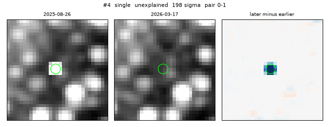
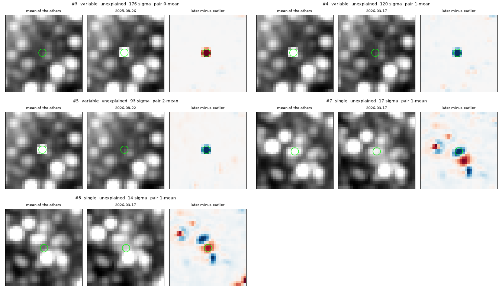
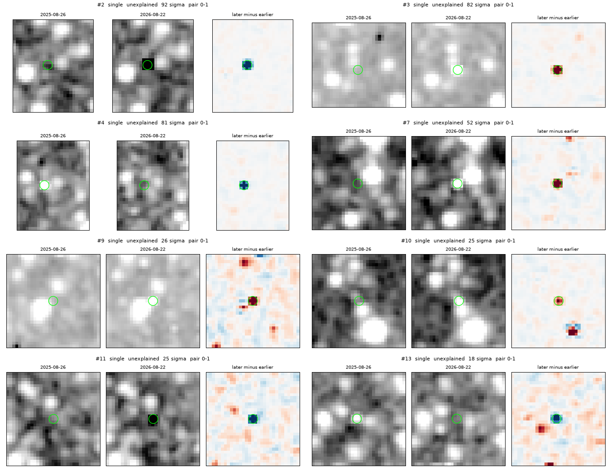
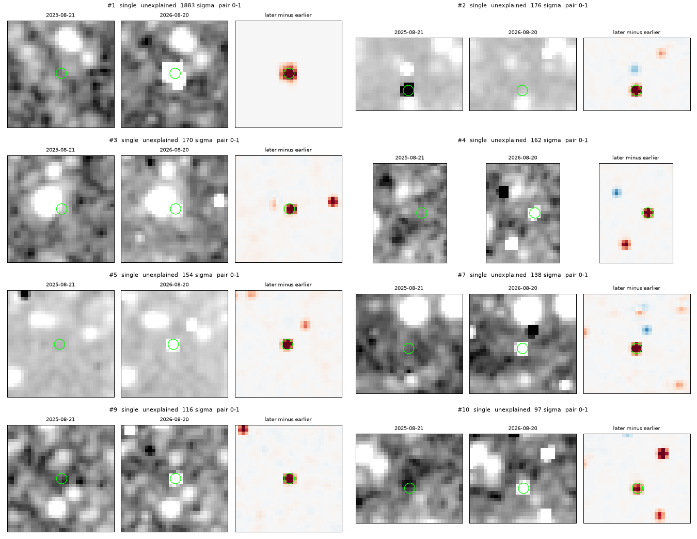
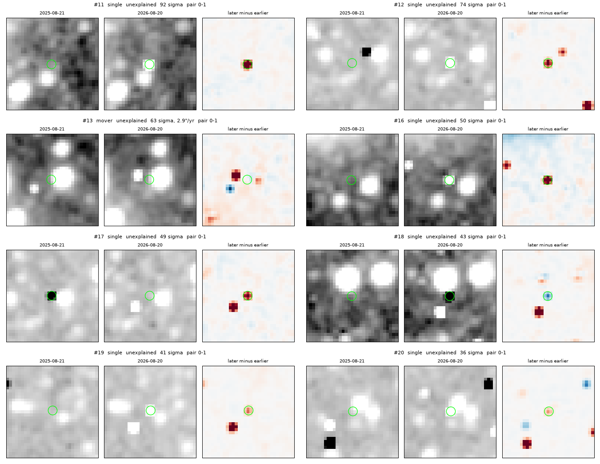
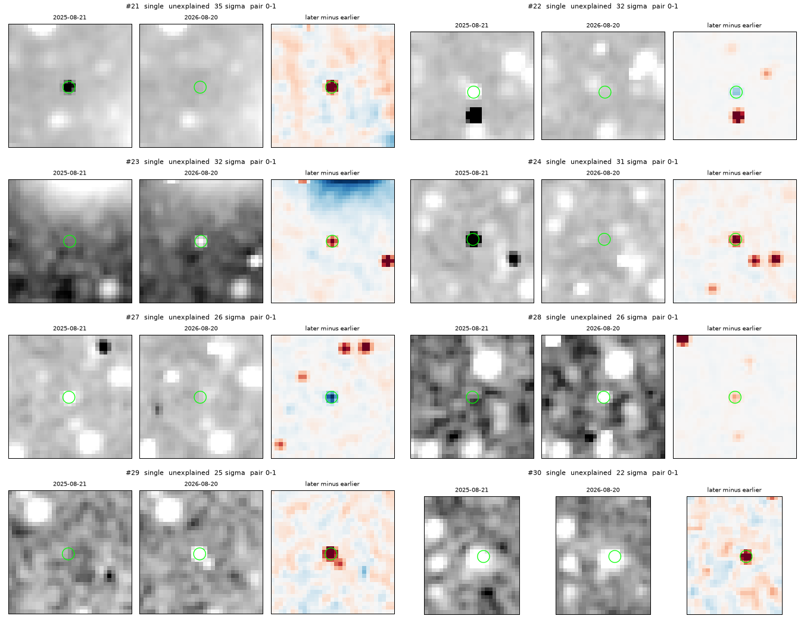
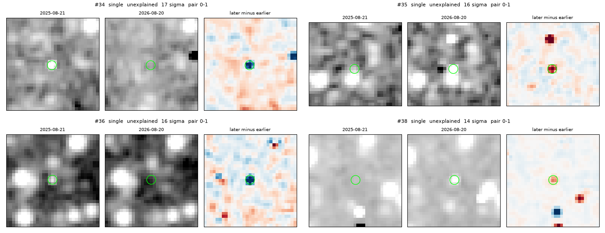
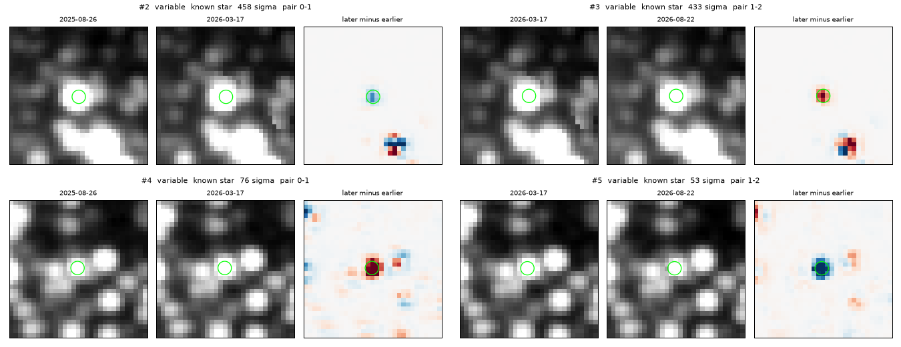

# Blind search: validation on real data

How well `api.find_movers` / `paramost search` (method in [API.md](API.md#blind-search),
code in `spherex/search.py`) works on SPHEREx data. Measured 2026-11-18 on the `search` branch.

**Short answer.** On the one field with local data it recovers the known mover, Barnard's Star,
as the most significant candidate in every detector and setting, with an implied proper motion of
9.3-10.6″/yr against the catalogue's 10.39″/yr. With the default sigma-clipped stacks almost
nothing else survives (0-3 unexplained candidates per field), and every unexplained candidate is,
on inspection, most likely an artefact. That is one field, one mover and no known asteroid: far
too little to say the search finds new objects. Read the limits below before using it.

## What was run

- **Data.** Only Barnard's Star has SPHEREx images on this machine (D2: 3 visits; D3, D5, D6: 2
  visits; D1, D4: 1 visit, so no pair). WISE 0855, Epsilon Indi B, RW Aur and R Draconis are not
  downloaded, and nothing was downloaded for this check. So the saturated-star ring cut was **not**
  tested on R Draconis, and only one mover could be recovered.
- **Blind.** The field is the 10′ grid the app builds around the target, but the search never uses
  the target position: detection, cuts, classification and catalogue matching work on the whole
  grid. The position is only used to find the cutout files (which were requested around it).
- **Settings.** `fov=10`, 5 sigma, every detector with two or more visits, `clip` on and off;
  for D2 (3 visits) also `pairs="all"` and `method="minus_mean"`. Gaia DR3, CatWISE2020 and SkyBoT
  on. None of these catalogues is served by CDS, so the CDS outage did not affect this check.
- **Catalogue values for Barnard's Star** (Gaia DR3 4472832130942575872): proper motion
  10.39″/yr toward position angle 355.6° (−0.80″/yr in RA, +10.36″/yr in Dec).

## Recovery of Barnard's Star

| Field | Pair (dates) | Rank | Significance | Implied pm (″/yr) | PA (°) | Gaia match |
|---|---|---|---|---|---|---|
| D2, clip | 0-1 (2025-08-26 → 2026-03-17) | 1 | 83 329 | 10.46 | 348.3 | 0.84″ |
| D2, clip | 1-2 (2026-03-17 → 2026-08-22) | 2 | 52 232 | 10.45 | 340.4 | 0.35″ |
| D2, no clip | 0-1 | 1 | 46 608 | 10.38 | 350.5 | 0.81″ |
| D2, no clip | 1-2 | 2 | 37 659 | 9.99 | 341.1 | 0.33″ |
| D3, clip / no clip | 0-1 (2025-08-21 → 2026-08-20) | 1 | 138 128 / 122 527 | 9.33 / 9.33 | 350.3 / 349.9 | 0.56″ / 0.59″ |
| D5, clip / no clip | 0-1 (2025-08-26 → 2026-08-22) | 1 | 230 430 / 191 802 | 10.54 / 10.50 | 348.2 / 348.6 | 0.74″ / 0.75″ |
| D6, clip / no clip | 0-1 (2025-08-21 → 2026-08-20) | 1 | 106 536 / 89 547 | 10.36 / 10.36 | 351.8 / 351.6 | 0.71″ |
| D2, clip, all pairs | 0-2 (one year) | 1 | 99 420 | 10.42 | 345.1 | 0.34″ |
| D2, clip, minus mean | 0-mean / 2-mean | 1 / 2 | 98 717 / 76 497 | 10.58 / 9.99 | 346.2 / 343.5 | 1.55″ / 0.34″ |
| D2, no clip, minus mean | 2-mean / 0-mean | 1 / 2 | 43 320 / 41 718 | 9.78 / 10.36 | 344.8 / 348.0 | 0.32″ / 1.29″ |

In every pair the top candidate is Barnard's Star, classified `mover`, labelled `known star`, and
its verdict says the catalogue motion agrees. The speed is right to −10%…+2%. The direction is
systematically 4-15° west of the catalogue's: an extra westward shift of about 0.2 grid pixel per
half year, larger than the 0.01-0.13 px that static saturated stars in the same field move. Most
likely the centroid of the saturated, filled-in core is slightly biased; not investigated further.

Barnard's Star is saturated in every frame (a core of 290-390 grid pixels). Its motion comes from
the flux-centroid shift of the whole star between the two stacks, not from the dipole lobes: at
1.5-1.9 grid pixels per pair, the shift is less than one SPHEREx pixel, and the two lobes sit about
one PSF apart whatever the motion.

Two problems were found and fixed during this validation (both have tests):
- `minus_mean` compared a saturated star against an empty picture, so Barnard's Star's core was cut
  as "saturated star wings"; it now uses the mean of the other visits (dated at their mean date).
- At the first visit's date an unrelated G = 20.9 star lies 1.65″ from Barnard's Star, and the
  nearest-source rule matched the mover to it. Among sources within 3″ the match is now the one with
  the agreeing motion (movers) or the brightest (everything else).

## Candidates per field and what each cut removed

| Field | Visits (releases) | Residuals | Low coverage | Edge | Saturated star wings | Small change | Kept | Candidates | Known star | Known IR source | Known asteroid | Unexplained | Time (s) |
|---|---|---|---|---|---|---|---|---|---|---|---|---|---|
| D2, clip | 3 (DR1, DR1, QR3) | 208 | 0 | 24 | 20 | 151 | 13 | 9 | 6 | 0 | 0 | 3 | 3.2 |
| D2, no clip | 3 | 155 | 0 | 16 | 20 | 106 | 13 | 9 | 6 | 0 | 0 | 3 | 3.4 |
| D3, clip | 2 (DR1, QR3) | 113 | 0 | 12 | 10 | 88 | 3 | 2 | 2 | 0 | 0 | 0 | 2.2 |
| D3, no clip | 2 | 100 | 0 | 16 | 10 | 71 | 3 | 2 | 2 | 0 | 0 | 0 | 2.0 |
| D5, clip | 2 (DR1, QR3) | 31 | 0 | 3 | 0 | 26 | 2 | 1 | 1 | 0 | 0 | 0 | 1.9 |
| D5, no clip | 2 | 50 | 0 | 8 | 0 | 26 | 16 | 15 | 6 | 1 | 0 | 8 | 1.9 |
| D6, clip | 2 (DR1, QR3) | 13 | 0 | 1 | 0 | 10 | 2 | 1 | 1 | 0 | 0 | 0 | 1.7 |
| D6, no clip | 2 | 55 | 0 | 7 | 1 | 6 | 41 | 39 | 8 | 3 | 0 | 28 | 2.0 |
| D2, clip, all pairs | 3 | 310 | 0 | 36 | 28 | 230 | 16 | 10 | 7 | 0 | 0 | 3 | 3.3 |
| D2, clip, minus mean | 3 | 305 | 0 | 36 | 35 | 225 | 9 | 7 | 4 | 0 | 0 | 3 | 3.4 |
| D2, no clip, all pairs | 3 | 205 | 0 | 19 | 30 | 139 | 17 | 12 | 7 | 0 | 0 | 5 | 3.0 |
| D2, no clip, minus mean | 3 | 196 | 0 | 17 | 33 | 135 | 11 | 9 | 4 | 0 | 0 | 5 | 3.3 |

"Kept" counts residuals; a mover joins two (or more) of them into one candidate.

- **Low coverage removed nothing**: with 10′ fields served from the standard 0.25° cutouts every
  pixel has 15-25 frames in every visit. It matters for smaller cutouts and the few-frames visits
  (none here).
- **Small change does most of the work.** Most residuals are 5-25% of the star under them: a star
  that only looks different in the two visits (the focal plane is turned differently on each visit,
  and DR1 and QR3 are calibrated a few percent differently). The lobes of Barnard's Star are 57-93%.
  The 30% threshold was chosen on this field; it also removes real changes smaller than 30%.
- **Saturated star wings** removed 10-20 residuals per field around Barnard's Star and the other
  saturated stars, while keeping Barnard's Star's own core residuals (its centroid moved 1.5-3.5 px;
  static saturated stars 0.01-0.13 px).
- Every pair here except D2's 0-1 crosses the DR1 → QR3 boundary and is flagged `release_boundary`.

## clip on or off

Both settings recover Barnard's Star at rank 1 with the same motion (to 0.4″/yr). With `clip=False`
the D5 and D6 fields keep 8 and 28 unexplained candidates instead of 0: nearly all are single-frame
defects (below), which the sigma-clipped stack removes. The advantage of `clip=False` - keeping
sources that are in only part of a visit, such as asteroids and flares - could **not** be shown: SkyBoT
lists 0-2 known asteroids in the field per visit, and none lies on a candidate. **Use `clip=True`
(the default)**; try `clip=False` only for a field with a known fast mover, and expect defects.

## Every unexplained candidate, inspected

Thumbnails: earlier visit, later visit, later minus earlier (red = brighter later); the green circle
is the candidate; `#` numbers are the ones in the thumbnail titles. "Single-frame defect" = a sharp square one SPHEREx pixel wide (2 x 2 grid
pixels) that is bright or dark in one visit's plain-average stack only and absent from its clipped
stack: an unflagged hot pixel or cosmic ray in one frame.

**D2, clip (3; the same 3 with all pairs).** 
- #6 and #8, "mover", 31 and 23 σ, 2.0 and 4.2″/yr: the same place in both pairs, a tight group of
  faint blended stars (nearest Gaia G = 20.6 at 3-5″). The residual pattern flips between the pairs and
  the two implied motions disagree in size and direction: the group looks different in each visit.
  **Artefact** (point-spread-function residual of a blend).
- #7, "single", 30 σ: a faint bump at the edge of a bright neighbour's residual (that residual was cut
  as small change). **Artefact.**

**D2, no clip (3).** The same blend (#7, #8) and #4, 198 σ:
 a **single-frame defect** in the first visit.

**D2, minus mean (3 with clip, 5 without).** 
The blend and the bright neighbour again, and (no clip) the same single-frame defect of the first
visit three times: positive in 0-mean, negative in 1-mean and 2-mean, whose mean contains that visit.
It is therefore classified `variable`, seen in 2 of 2 other images. **Artefact**; see "seen_in" below.

**D5, no clip (8).** 
Five (#2, #3, #4, #7, #11) are **single-frame defects**. Three (#9, #10, #13; 18-26 σ) are soft
residuals next to stars, at a level where the noise of a plain-average stack is not Gaussian:
**unclear, most likely noise or star residuals.**

**D6, no clip (28).**

22 are **single-frame defects**, most of them bright squares in the 2026-08-20 (QR3) visit, the
strongest at 1883 σ. #13, "mover", 2.9″/yr, is **two defects** (one dark, one bright) that happened
to be paired. Five (#22, #30, #35, #36, #38; 14-32 σ) are faint and soft: **unclear, most likely noise
or star residuals.**

**D3, D5 and D6 with clip: none.**

No unexplained candidate looks like a real moving or changing object.

## The known-star candidates

Apart from Barnard's Star the `known star` candidates with clip are

- D2 #2/#3, `variable`, 433-458 σ, on a G = 13.7 star: a sharp one-to-two-pixel residual in the star's
  core that flips sign between the pairs: the core sampled differently, **not** a brightness change.
- D2 #4/#5, `variable`, 53-76 σ, on a G = 15.6 star that is about 30% brighter in the middle visit
  than in the other two (residual with the shape of the star): possibly a real change, possibly
  something about the middle visit (see below). Undecided.
- D3, a `single` on a G = 15.9 star (change 0.46): undecided.

## Limits, in order of importance

1. **One field, one mover, no asteroid.** Barnard's Star is the easiest mover there is (the highest
   proper motion of any known star, and bright). Nothing here shows that the search finds a
   faint or slow mover, a brown dwarf like WISE 0855, a variable like R Draconis or RW Aur, or an
   asteroid. The ring cut was designed for R Draconis but never run on it.
2. **"variable" is not independent confirmation.** With three visits, a change in the middle visit
   (a flare, a defect, a calibration difference) leaves residuals of opposite sign at one place in
   both consecutive pairs, exactly like a variable. With `pairs="all"` and `minus_mean` the images
   share visits, so one defect is counted several times.
3. **Catalogue labels can be chance.** In this crowded field a random position has a 16% chance of a
   Gaia source within 3″ and 14% of a CatWISE source (`chance_match`; at 6″ it would be 50%). A
   `known star` label says only that a star is there.
4. **The thresholds were set on this field** (30% small-change cut, 0.5 px moving-core threshold,
   2.5 r + 4 px ring radius). They are untested elsewhere.
5. The motion direction of Barnard's Star is 4-15° off (above).

## Repeatability and existing outputs

- **Deterministic:** the same field gives a byte-identical candidate table in separate runs.
- **Frame cache and workers:** D2 (clip) and D6 (no clip), with every stack rebuilt (saved results
  off): byte-identical tables with the frame cache cold (`SPHEREX_FRAME_CACHE=0`) and warm, and with
  1 and 8 workers (`SPHEREX_WORKERS`).
- **Existing outputs unchanged:** stacks and coverage maps (D2 at 4′ with clip, D2 at 10′ without,
  D5+D6 at 6′), a pair difference, the overlay notes and the light-curve table of Barnard's Star are
  byte-identical between the `before-search` tag and this branch (the search only adds code).
- **Time per field:** 1.7-3.4 s with the stacks in memory or saved; 2.3-6.2 s rebuilding them from
  cached images (cold frame cache, 1-8 workers). SkyBoT, asked twice per visit, added 15.5 s for
  the three D2 visits; a single slow SkyBoT call took 54 s on 2026-11-17 (astroquery then caches
  its answers); `--no-asteroids` skips it.
