# Blind search: validation on the five challenge fields

How well `api.find_movers` / `paramost search` (method in [API.md](API.md#blind-search), code in
`spherex/search.py`) works on real SPHEREx data. Measured 2026-11-19 on the `search` branch with
`tools/validate_search.py` (the five fields) and `tools/search_null_control.py` (the
false-positive control); both rerun everything below from the downloaded images.

## What it can and cannot do

- **It finds bright, fast movers.** With clipping, Barnard's Star (10.4″/yr) and Epsilon Indi B
  (4.7″/yr) are the top-ranked candidates in every pair, classified `mover`, with the implied motion
  within 24% of the catalogue (Barnard's Star within 4%).
- **It does not find faint movers.** WISE 0855 (8.1″/yr, but faint in SPHEREx) leaves a dipole at
  the noise level: one lobe passes as a lone `single`, no motion is measured, and the label names
  the neighbouring star. Without clipping it is not found at all.
- **It does not see changes in saturated stars.** RW Aur really brightened by 30% between visits
  and R Draconis faded by 22%, but both are saturated, and the cut that removes the rings and wings
  of saturated stars removes their real change too. Neither is reported.
- **With clipping (the default), false positives are few:** with nothing changing, 1.8 false
  candidates per visit pair survive, 0.3 of them unexplained. Without clipping, 7.1 per pair (6.0
  unexplained), mostly single-frame defects. **Keep `clip=True`.**
- **No unexplained candidate in any field is a real object** on inspection.

So: a bright fast mover in a SPHEREx field shows up first; anything else in the table is most
likely an artefact or a star that looks different in the two visits. That is useful for confirming
and measuring known high-proper-motion stars, and not (yet) for finding new objects.

## The fields

| Target | Detector | Visits: frames (release) | Catalogue motion | Download (first view) |
|---|---|---|---|---|
| Barnard's Star | D2 | 2025-08-26: 18, 2026-03-17: 18, 2026-08-22: 25 (DR1, DR1, QR3) | 10.39″/yr, PA 355.6° | already local |
| Epsilon Indi B | D5 | 2025-05-13: 31, 2025-10-12: 24, 2026-04-25: 7, 2026-09-30: 24 (DR1 ×3, QR3) | 4.71″/yr, PA 122.6° | 86 images, 4.8 min |
| WISE 0855 | D6 | 2025-05-05: 3, 2025-11-16: 21, 2026-04-27: 21 (DR1) | 8.15″/yr, PA 274.8° | 45 images, 2.2 min |
| RW Aur | D1 | 2025-09-03: 19, 2026-03-07: 19, 2026-09-06: 18 (DR1, DR1, QR3) | (variable) | 56 images, 1.9 min |
| R Draconis | D3 | 2025-06-03: 23, 2026-01-01: 24, 2026-05-15: 44 (DR1, DR1, DR1 + QR3) | (variable) | 91 images, 3.2 min |

Downloads: 278 images in 721 s with the adaptive concurrency, 2.0-3.3 s per image. The README says
a first view takes "about 1-3 minutes"; that held for two of the four fields, R Draconis took 3.2 min
and Epsilon Indi B 4.8 min. Every field searched with `fov=10`, threshold 5, consecutive pairs, Gaia
DR3 + CatWISE2020 + SkyBoT, and never told where its target is.

## Per target

`peak_to_noise` is a ranking score (residual peak / scatter of the blank parts of the difference),
not a significance: see [API.md](API.md#blind-search).

| Target | clip | Recovered? | Rank | Type | Implied motion (″/yr) | PA (°) | Distance from prediction |
|---|---|---|---|---|---|---|---|
| Barnard's Star | on | yes, both pairs | 1, 2 | mover | 10.46, 10.45 | 348, 340 | 0.8″, 0.4″ |
| Barnard's Star | off | yes, both pairs | 1, 2 | mover | 10.38, 9.99 | 350, 341 | 0.8″, 0.4″ |
| Epsilon Indi B | on | yes, all three pairs | 1, 2, 3 | mover | 4.70, 5.23, 5.53 | 151, 154, 99 | 0.9″, 0.9″, 2.0″ |
| Epsilon Indi B | off | yes, all three pairs | 9, 10, 11 | mover | 4.30, 5.38, 5.78 | 152, 156, 102 | 0.9″, 0.9″, 2.0″ |
| WISE 0855 | on | one lobe, pair 1-2 | 1 (of 1) | single | - | - | 3.1″ |
| WISE 0855 | off | no | - | - | - | - | - |
| RW Aur | on / off | no | - | - | - | - | - |
| R Draconis | on / off | no | - | - | - | - | - |

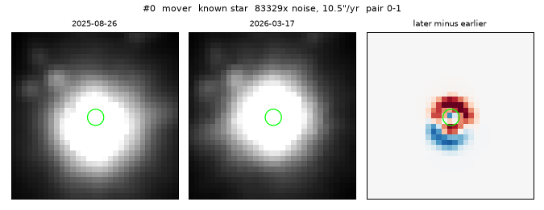
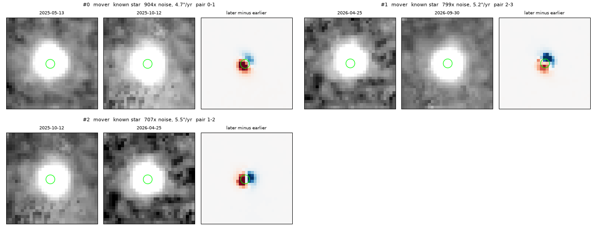

What each cut removed, and what survived:

| Target | clip | Residuals | Low coverage | Edge | Saturated-star wings | Small change | Rescued lobes | Kept | Candidates | Unexplained | Rest of field (> 2′ from target) | Time (s) |
|---|---|---|---|---|---|---|---|---|---|---|---|---|
| Barnard's Star | on | 208 | 0 | 24 | 20 | 149 | 2 | 15 | 9 | 3 | 7 (3 unexplained) | 3.3 |
| Barnard's Star | off | 155 | 0 | 16 | 20 | 105 | 1 | 14 | 10 | 3 | 8 (3) | 3.4 |
| Epsilon Indi B | on | 38 | 0 | 10 | 0 | 15 | 2 | 13 | 10 | 7 | 6 (6) | 4.2 |
| Epsilon Indi B | off | 60 | 0 | 8 | 0 | 8 | 3 | 44 | 40 | 33 | 30 (26) | 4.2 |
| WISE 0855 | on | 13 | 7 | 1 | 0 | 4 | 0 | 1 | 1 | 0 | 0 | 2.1 |
| WISE 0855 | off | 67 | 20 | 6 | 0 | 4 | 0 | 37 | 35 | 30 | 29 (25) | 2.2 |
| RW Aur | on | 264 | 0 | 32 | 24 | 199 | 0 | 9 | 9 | 2 | 7 (1) | 3.0 |
| RW Aur | off | 188 | 0 | 23 | 24 | 136 | 0 | 5 | 5 | 1 | 5 (1) | 2.8 |
| R Draconis | on | 19 | 0 | 4 | 8 | 4 | 2 | 3 | 1 | 0 | 1 (0) | 3.9 |
| R Draconis | off | 24 | 0 | 4 | 9 | 7 | 0 | 4 | 4 | 4 | 4 (4) | 4.0 |

Within 6′ of each field's centre Gaia lists no star faster than 0.2″/yr except the target itself (WISE
0855 is too faint for Gaia), so no known second mover is hiding among the rest-of-field candidates.
Times are with the stacks in memory or saved; rebuilding them from the cached images takes 2.7-8.2 s
per field with a cold frame cache. SkyBoT adds seconds to a minute per visit the first time.

### Barnard's Star

The easy case: bright and fast, 1.5-1.9 grid pixels per pair. It is saturated in every frame; its
motion comes from the shift of the whole star's flux centroid between the two stacks. The direction is
systematically 5-16° west of the catalogue's (0.2 px per half year; static saturated
stars in the field move 0.01-0.13 px). The 7 other candidates: a tight group of blended faint stars
that looks different in each visit (two `mover`s, 2-4″/yr, at a star Gaia says does not move), a
residual at the edge of a bright neighbour, and stars whose cores look different in the two visits
(the same effect the false-positive control shows).
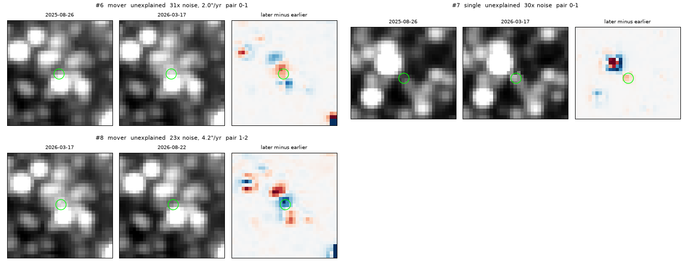

### Epsilon Indi B: the DR1/QR3 boundary

Found in all three pairs once its uneven lobes are judged together (see "What changed" below); motion
4.70-5.53″/yr against 4.68 in Gaia. The direction is poor (99-154° against 122.6°): the shift per pair
is only 0.65-0.84 grid pixels. **The release boundary does not create false variables**: the DR1 → QR3
pair (2-3) has 2 candidates and no variables (the target and one unexplained), the two DR1 pairs 8;
a few-percent calibration step is far below the 30% small-change cut. Of its 7 unexplained candidates
with clip, 6 (268-291″ from the target, near the field edge) are diffuse patches in a smooth brightness
gradient, not point sources: most likely scattered light from a bright star outside the field that
changed between visits (not checked further); the seventh, 41″ from the target, is a featureless spot
next to a bright star's residual.
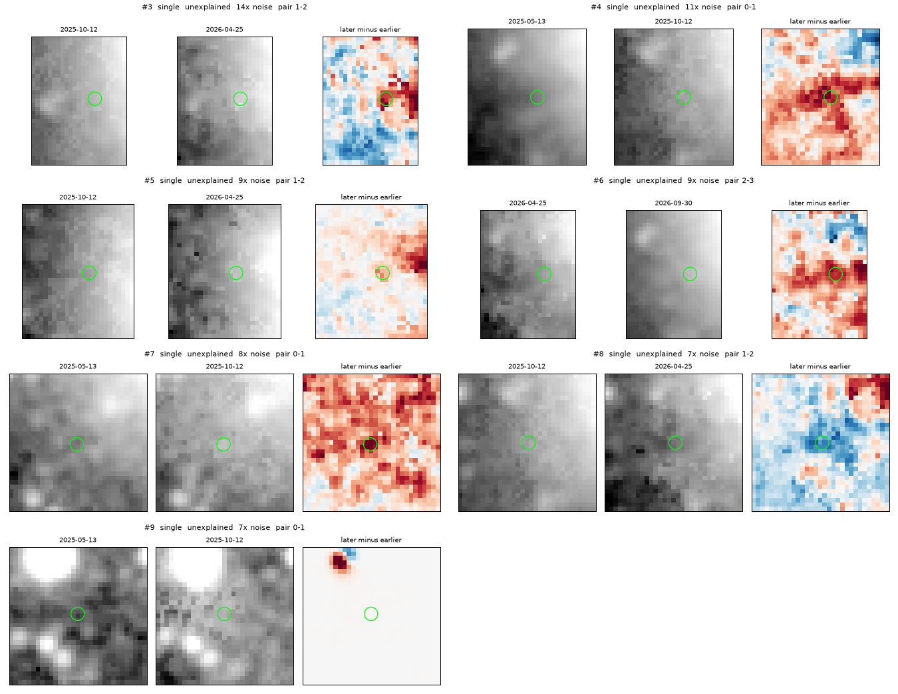

### WISE 0855: faint, with the G = 16.3 neighbour

The target is only 13-21 times the noise in each stack. Its first visit has 3 frames, so pair 0-1 is
cut as low coverage. In pair 1-2 the dipole is at the noise level (smoothed: old lobe 5.4x, new lobe
7.6x the noise); only the new lobe passes, as a lone `single` at peak_to_noise 12.5, 3.1″ from the
prediction, so no motion is measured. **The label is wrong about what it is**: the G = 16.3 neighbour
lies within 3″, so it says "known star"; the CatWISE source 1.7″ away is most likely WISE 0855 itself
(not checked). The neighbour does not break the pairing; the missing lobe is simply too faint. The
search does not find WISE 0855 as a mover. Without clipping it is not found at all (the plain-average
stacks are noisier), and 30 single-frame defects take its place.
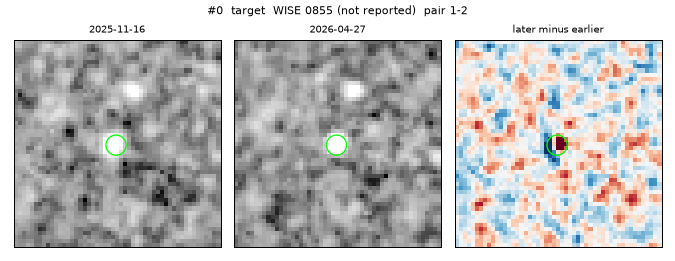

### RW Aur: real variability, not reported

RW Aur brightened from 663 to 859 to 1103 (sum over 9 x 9 pixels, stack units: +30% per pair) and
leaves residuals of 3775 and 3552 x noise. But it is saturated in D1 (10-15 saturated pixels in its
core in every visit), its core does not move, and so the saturated-star cut removes all of its
residuals with the wings. **It does not come out as a variable.** The 9 candidates are field stars:
residuals of stars whose cores look different (30-54%, the null control's range), 2 unexplained.
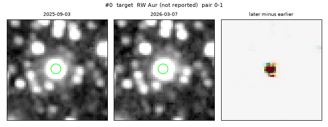
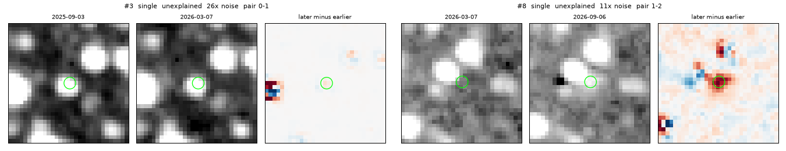

### R Draconis: saturated rings

The cut holds. Its saturated core covers 700-930 grid pixels (wings cut out to 130-140″); of 19
residuals in the field 8 are cut as saturated-star wings, all within 80 px of it, and 1 candidate
survives (a known star). The table is not flooded. R Draconis itself faded 22% between the last two visits and is not
reported, for the same reason as RW Aur. Without clipping 4 `variable`s appear at two places: large
round discs in the middle visit's plain-average stack only, removed by clipping. They look like
optical ghosts of R Draconis in a few frames (SPHEREx has GHOST flags, which the cleaning does not
mask); I could not check the flags here.
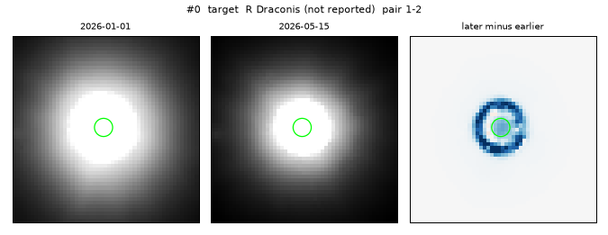
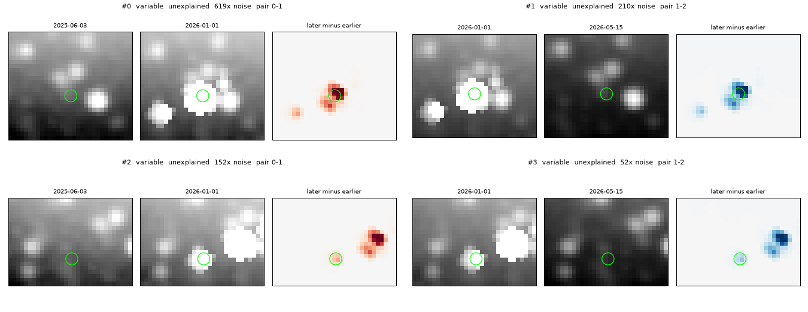

## False-positive control

`tools/search_null_control.py`: each visit's frames are split into two interleaved halves, each
stacked on its own (on one grid), and the two halves differenced and searched exactly like a pair.
Nothing moves or changes in the few days between them, so **every surviving candidate is a false
positive**. The halves have half the frames of a visit, so this is pessimistic.

| Field | Null pairs | clip on: candidates (unexplained) | clip off: candidates (unexplained) |
|---|---|---|---|
| Barnard's Star D2 | 3 | 16 (4) | 11 (4) |
| Epsilon Indi B D5 | 5 | 2 (1) | 49 (46) |
| WISE 0855 D6 | 3 | 0 (0) | 49 (42) |
| RW Aur D1 | 3 | 13 (0) | 7 (5) |
| R Draconis D3 | 3 | 0 (0) | 5 (5) |
| **All** | **17** | **31 (5): 1.8 per pair (0.3)** | **121 (102): 7.1 per pair (6.0)** |

With clipping the false candidates are stars whose cores look different between two stacks of the
same visit, with nothing changing (change 0.30-1.12, 81% of them 0.30-0.50): SPHEREx's 6″ pixels undersample the star, so a star's peak
depends on how the frames fell on it. That is the same size as the "variables" on known stars in the
real fields, which are therefore most likely the same effect. All null candidates are `single`s: the
halves are days apart, under the 0.1 yr below which no mover is formed, so this control cannot measure
false movers. In the real fields false movers appeared from blended stars (Barnard's Star field) and,
without clipping, from two defects paired by chance (WISE 0855).

## clip on or off

Clipping wins everywhere: the same recoveries (Barnard's Star, Epsilon Indi B), WISE 0855 only with
it, and 1.8 instead of 7.1 false candidates per pair. Without it the tables fill with single-frame
events (sharp one-pixel squares, and in Epsilon Indi B large irregular blobs that look like
"snowball" cosmic-ray events, also not masked by the cleaning; flags not checked):
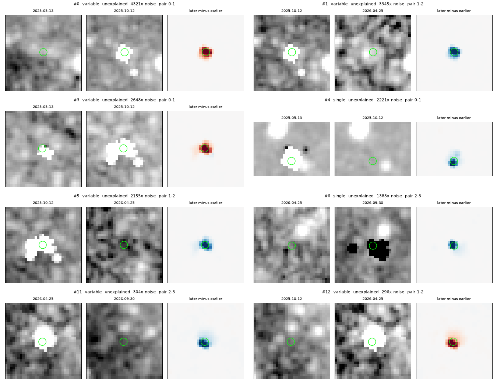
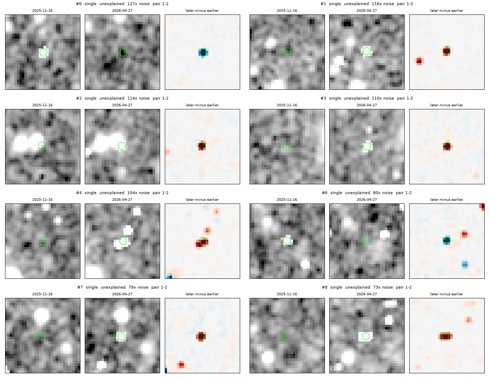
SkyBoT lists 0-2 known asteroids per visit in these fields and none lies on a candidate, so the one
case where `clip=False` should help - a fast asteroid - could not be tested.

## Every unexplained candidate, inspected

| Field | clip | Unexplained | What they are |
|---|---|---|---|
| Barnard's Star | on | 3 | a blended group of faint stars (2, one per pair) and the edge of a bright neighbour's residual |
| Barnard's Star | off | 3 | the same blend (2) and a single-frame defect |
| Epsilon Indi B | on | 7 | diffuse patches in a smooth background gradient near the field edge (6), a featureless spot next to a bright star's residual (1) |
| Epsilon Indi B | off | 33 | single-frame events (large bright or dark blobs and one-pixel squares in one stack only), and the same diffuse patches |
| WISE 0855 | off | 30 | single-frame defects; its one "mover" is two defects paired by chance |
| RW Aur | on / off | 2 / 1 | a faint core residual on a field star, a blob beside a star next to a defect / a faint residual (7x) beside a star |
| R Draconis | off | 4 | two places with large discs in one visit only (likely ghosts of R Draconis; flags not checked) |

None looks like a real moving or changing object.

## What changed in the search during this validation

Three logic problems were found and fixed, each with a test:

- **A saturated core cannot move between pictures days apart.** In the null control Barnard's Star's
  filled-in core "moved" more than 0.5 px between two halves of one visit, and became the top false
  positive (peak_to_noise 44 000). Pictures less than 0.1 yr apart now treat saturated cores as static.
- **A dipole is judged as a whole.** Epsilon Indi B's lobes are uneven (fluxes 61 and 21); the weaker
  one alone fell under the small-change cut, so in two of its three pairs only a lone single was left.
  Such a lobe now comes back when a kept lobe of the other sign is within dipole range, and is
  dropped again if it ends up in no dipole. Cost, measured: two more false movers in the Barnard's
  Star field, four more candidates in its null control.
- **`significance` was renamed `peak_to_noise`**, with its definition in the table, the CLI and the
  docs: it is a ranking score, and stars that do not change reach 44 (median) to 774 in it.

None of the thresholds (30% small change, 0.5 px moving core, ring radius, 5x threshold) was changed
to make a target appear. They were set on the Barnard's Star field and are untested beyond these five.

## Repeatability and existing outputs

- **Deterministic:** the same field gives a byte-identical candidate table in separate runs.
- **Frame cache and workers:** Barnard's Star D2 (clip), Epsilon Indi B D5 (clip) and WISE 0855 D6 (no
  clip), every stack rebuilt (saved results off): byte-identical tables with the frame cache cold and
  warm and with 1 and 8 workers. 2.2-8.2 s per field including the stacking.
- **Existing outputs unchanged:** stacks and coverage maps (Barnard's Star D2 at 4′ with clip, D2 at
  10′ without, D5+D6 at 6′), a pair difference, overlay notes and the light-curve table are
  byte-identical to the `before-search` tag; `spherex/` gained only `search.py` and additions to `api.py`.
